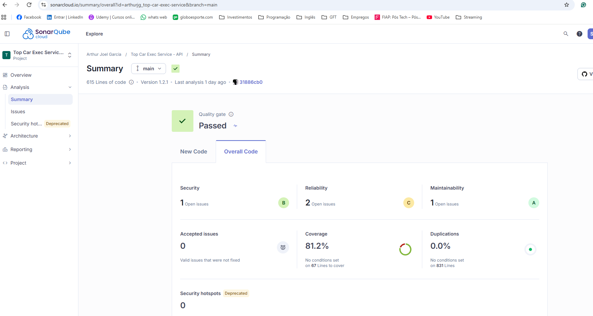
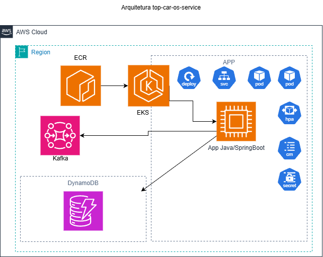
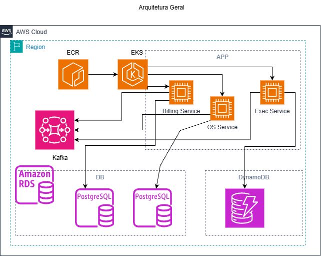

# Top Car Exec Service API 

microserviço/API de fila de execução de ordens da oficina top-car-service, com foco em gestão de execução de ordens de serviço.


## Como Executar localmente

### Pré-requisitos / Ferramentas

- **Java 21** ou superior
- **Git**
- **Docker** e **Docker Compose**
- **Kubernetes**


### 1.1. Preparação do Ambiente

* Clone e build do repositório:
```bash
git clone https://github.com/arthurjg/top-car-exec-service.git

cd top-car-exec-service
cd app
mvnw package
docker build -t top-car-exec-service:v1 .
```

## Notas da versão

### Nota versão 1.4.0 (Fase 4)

#### Objetivos/Entregáveis dessa Fase

- Refatoração/Separação de microserviços em: gestão OS, Billing e Execução OS;
- Refatoração/implementação de comunicação síncrona/assincrona e padrão SAGA;
- Implementação de testes unitários, BDD, cobertura de 80% e validação de qualidade com SonarQube;
- Pipelines/CI/CD com build, testes, qualidade com Sonar e deploy em Kubernetes  

## Detalhes/Entregáveis dessa Fase/Versão

### Documentação da API - Swagger

não há API exposta

### Cobertura de Testes - SonarQube

#### URL

https://sonarcloud.io/summary/overall?id=arthurjg_top-car-exec-service&branch=main

#### Print



### Diagrama da Arquitetura Microserviço



### Diagrama da Arquitetura Geral



### Detalhamento Estratégia SAGA

A estratégia SAGA escolhida foi: **Coreografada** pois facilita a independência entre os microserviços e contribuiu para manter os fluxos assíncronos.
